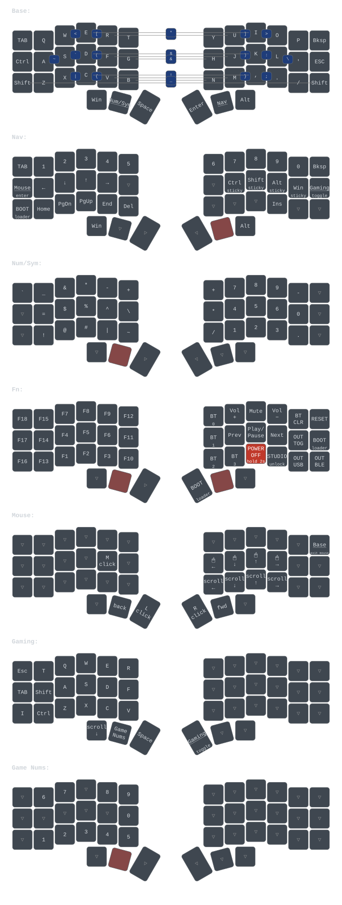

# zmk-config — Corne Chocolate v2 (wireless)

ZMK firmware configuration for a hand-built **wireless split Corne** keyboard.
GitHub Actions compiles this repo into `.uf2` firmware files that get flashed onto the two halves.



---

## Hardware

| Part | Detail |
|---|---|
| PCB | foostan **Corne Chocolate v2** (crkbd), hotswap, Kailh Choc v1 switches |
| Layout | 3×6 + 3 thumb keys per half = **42 keys** |
| Controllers | 2× **AITRIP Pro Micro nRF52840** (nice!nano v2 clone, "SuperMini" style) |
| Bootloader | Adafruit UF2 0.6.0, `Board-ID: nRF52840-nicenano`, SoftDevice S140 6.1.1 — same as a genuine nice!nano |
| Display | **None** (display support is disabled on purpose) |
| Power | LiPo battery per half; no hardware power switch — uses ZMK soft-off instead |

## Firmware summary

- **ZMK** (`main` branch), board `nice_nano//zmk`, shields `corne_left` / `corne_right`
- **Left half = central** (talks to the computer). **Right half = peripheral** (talks to the left half).
- **ZMK Studio** enabled on the left half → live key remapping at <https://zmk.studio> over USB
- Display + RGB underglow **off** (battery life)
- Deep sleep after **30 min** idle; any key wakes it
- **Soft-off** key (software power switch); reset button turns it back on
- **Mouse keys** enabled (`CONFIG_ZMK_POINTING`)
- Bluetooth TX power +8 dBm, experimental connection fixes, battery level of both halves reported to the host
- Layout based on [cyb3rkun/corneGLP](https://github.com/cyb3rkun/corneGLP) (MIT), with the numpad moved to the right hand and thumb layer keys swapped

## Repo layout

```
build.yaml                     # what GitHub Actions builds (left w/ Studio, right, settings_reset)
config/
  corne.keymap                 # the keymap: layers, combos, behaviors
  corne.conf                   # Kconfig settings for BOTH halves (sleep, power, BT, mouse, no display)
  west.yml                     # pulls ZMK main
.github/workflows/build.yml    # uses ZMK's reusable build workflow
docs/
  keymap.svg                   # layout picture (generated, see "Updating the picture")
  keymap-drawer.config.yaml    # labels/theme used to draw it
```

## Layers

Thumb keys (left → right): **Win · Num/Sym · Space** | **Enter · Nav · Alt**

| # | Layer | How to reach it | What's on it |
|---|---|---|---|
| 0 | Base | always | QWERTY. `'` on the `;` spot, Esc on outer right, Shift on both outer bottoms. **Combos** (below). |
| 1 | Nav | hold **right** middle thumb | Number row 1–0 · arrows on A S D F · Home/PgDn/PgUp/End/Del on Z X C V B · sticky Ctrl/Shift/Alt/Win on J K L ; · Ins on `.` · **Mouse toggle** = outer-left Ctrl spot · **Gaming toggle** = outer-right Esc spot · bootloader on outer-left bottom |
| 2 | Num/Sym | hold **left** middle thumb | **Numpad on right hand**: U I O = 7 8 9, J K L = 4 5 6, M , . = 1 2 3, `'` spot = 0, plus `+ - * / .` around it · symbols `` ` _ & * - + = $ % ^ \ ! @ # \| ~ `` on the left hand |
| 3 | Fn | hold **both** middle thumbs (conditional layer 1+2) | F1–F18 (left) · media keys · BT profiles 0–3 · BT clear · USB/BLE output · reset · bootloader · **Power off** = comma spot (hold 2 s) · **Studio unlock** = period spot |
| 4 | Mouse | toggled from Nav | Move on H J K L, scroll on N M , . · L/R click on inner thumbs, back/forward on middle thumbs, middle click on F · exit = top-right key |
| 5 | Gaming | toggled from Nav | Left half shifted one column so WASD sits under the fingers; Esc/Tab/I and T/Shift/Ctrl on the outer columns; Space on thumb · exit = Enter-thumb key |
| 6 | Game Nums | hold left middle thumb while in Gaming | Numbers 1–0 around WASD for hotbars |
| 7–8 | (reserved) | — | Empty slots for new layers created in ZMK Studio |

### Combos (Base layer only — press two adjacent keys together)

| Keys | Output | Keys | Output |
|---|---|---|---|
| W+E | `<` | O+I | `>` |
| E+R | `[` | U+I | `]` |
| E+I | `*` | R+U | `+` |
| D+F | `(` | J+K | `)` |
| S+D | `` ` `` | A+S | `~` |
| F+J | `=` | D+K | `$` |
| G+H | `&` | K+L | `:` |
| L+' | `\` | , + . | `;` |
| C+V | `{` | M+, | `}` |
| X+C | `\|` | V+M | `-` |
| B+N | `_` | C+, | `!` |
| L-Shift + R-Shift | Caps Lock | | |

## Building

Push any change → **Actions** tab runs automatically (or *Run workflow*). When it's green, open the run → **Artifacts** → download `firmware.zip`. Inside:

| File | Flash to | Purpose |
|---|---|---|
| `corne_left_studio.uf2` | left half | normal firmware with ZMK Studio |
| `corne_right-nice_nano…zmk.uf2` | right half | normal firmware |
| `settings_reset-nice_nano…zmk.uf2` | either half | wipes saved settings (pairing + Studio edits) |

If the build ever fails with "board not found", ZMK is older than expected: change `nice_nano//zmk` to `nice_nano_v2` in `build.yaml`.

## Flashing

1. Plug the half in by USB, **double-tap reset**. A USB drive appears (it contains `INFO_UF2.TXT`).
2. Drag the right `.uf2` onto it. **Success = the drive disappears by itself** within a second or two (Windows may complain the copy didn't finish — ignore it).
3. Do the other half.

Normal updates: flash only the left and right files. Halves stay paired.

**Clean start / halves won't pair:** flash `settings_reset` to **both** halves, then the normal files to both, then press reset on both halves at the same time and re-pair "Corne" in Bluetooth settings (remove the old entry first).

## ZMK Studio (remapping without rebuilding)

1. Plug the **left** half in by USB (on Windows, Studio works over USB only).
2. Open <https://zmk.studio> in Chrome/Edge → connect.
3. Unlock: hold both middle thumbs (Fn) and tap the **period** key.
4. Click keys, change them, save. Changes are live immediately and stored on the keyboard.

**Important:** Studio edits are saved in the controller's settings storage and **override `corne.keymap`**, even across reflashes. After editing `corne.keymap` in this repo and flashing, click **Restore Stock Settings** in Studio (or flash `settings_reset`) or the old Studio layout will keep loading.

Studio can't edit combos, conditional layers, or Kconfig settings — those live in this repo.

## Power

- **Off:** hold both middle thumbs (Fn) + hold **comma** for 2 seconds. Note: the right half shuts off as soon as the key is pressed, even if the hold is released early (ZMK split behavior); press its reset button if that happens.
- **On:** press the reset button on each half.
- **Sleep:** automatic after 30 min idle (`CONFIG_ZMK_IDLE_SLEEP_TIMEOUT`), any key wakes it.

## Changing settings (`config/corne.conf`)

| Setting | Value | Why |
|---|---|---|
| `CONFIG_ZMK_DISPLAY` / `CONFIG_ZMK_RGB_UNDERGLOW` | `n` | No screen installed; both drain battery |
| `CONFIG_ZMK_SLEEP` / `CONFIG_ZMK_IDLE_SLEEP_TIMEOUT` | `y` / `1800000` | Deep sleep after 30 min (ms) |
| `CONFIG_ZMK_PM_SOFT_OFF` | `y` | Enables the `&soft_off` key |
| `CONFIG_ZMK_POINTING` | `y` | Mouse keys |
| `CONFIG_BT_CTLR_TX_PWR_PLUS_8` | `y` | Stronger BT signal (clone antennas are weak) |
| `CONFIG_ZMK_BLE_EXPERIMENTAL_CONN` | `y` | Connection-stability fixes |
| `CONFIG_ZMK_SPLIT_BLE_CENTRAL_BATTERY_LEVEL_*` | `y` | Host sees both halves' battery |

Studio itself is enabled only for the left half via `build.yaml` (`snippet: studio-rpc-usb-uart`, `-DCONFIG_ZMK_STUDIO=y`).

## Updating the picture

```bash
pip install keymap-drawer
keymap -c docs/keymap-drawer.config.yaml parse -z config/corne.keymap > keymap.yaml
keymap -c docs/keymap-drawer.config.yaml draw keymap.yaml > docs/keymap.svg
```

## Notes for an AI / anyone editing the keymap

- Key positions are numbered **0–41**, row by row, left half then right half on each row:
  row 0 = `0–11`, row 1 = `12–23`, row 2 = `24–35`, thumbs = `36–41` (36 = left outer, 38 = left inner/Space, 39 = Enter, 41 = right outer).
  Combos use these numbers in `key-positions`.
- Every layer's `bindings` must contain exactly **42** entries.
- Layer indices matter: `&tog 4` = Mouse, `&tog 5` = Gaming, `&mo 6` = Game Nums, conditional layer `if-layers = <1 2>` → `then-layer = <3>` (Fn). Don't reorder layers without updating these.
- Reserved layers (`status = "reserved"`) exist so ZMK Studio can create new layers; keep them last.
- Behaviors used: `&kp &mo &tog &sk &bt &out &mmv &msc &mkp &soft_off &studio_unlock &bootloader &sys_reset`.
- `&soft_off` has `hold-time-ms = <2000>` set at the top of the keymap.
- The controllers are nice!nano clones; always build for the `nice_nano` board.
- This is a wireless ZMK build. QMK/VIA/Vial/Remap firmware does not support Bluetooth on these controllers.
